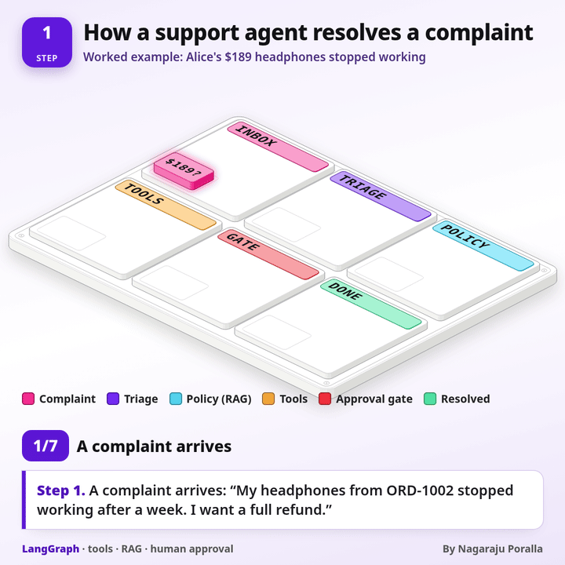
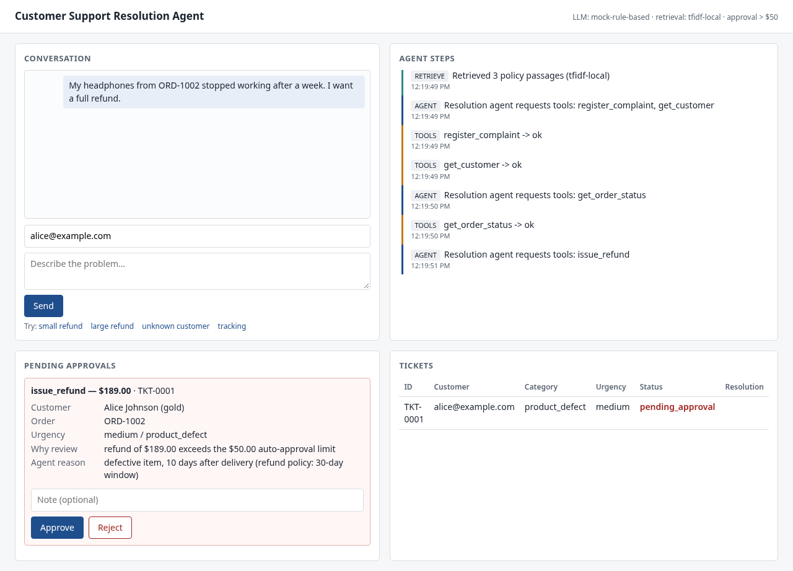
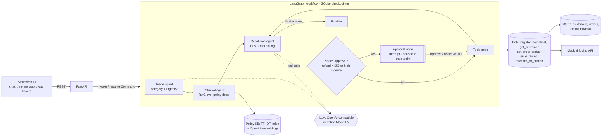

# Customer Support Resolution Agent



A multi-agent customer-support workflow built with **LangGraph**, **FastAPI** and **Pydantic**.
It triages a complaint, retrieves relevant policy via RAG, resolves it with tool calling (tickets, customer lookup,
shipping status, refunds, escalation), and **pauses for human approval** on risky actions using LangGraph's
checkpointed `interrupt()`. It runs fully offline with a deterministic mock LLM, or against any OpenAI-compatible API.

*Author: Nagaraju Poralla*

> **Live demo:** runs in offline **Demo mode** (deterministic mock LLM, no API key). Free hosting sleeps when idle, so the first load can take ~30-60s. See `render.yaml`.



## Architecture



| Node | Role |
|---|---|
| `triage` | Classifies `billing / delivery / product_defect / account` + `low / medium / high` urgency. Falls back to rules if the LLM fails. |
| `retrieve` | Top-k policy passages (refund, shipping, warranty, account) from a local TF-IDF index (no keys). Optional `EMBEDDINGS=openai`, with automatic fallback to local. |
| `agent` | Resolution agent: LLM function-calling loop (max 6 turns). On LLM outage it escalates, or apologises. |
| `approval` | Calls `interrupt(payload)`. State is checkpointed in SQLite so the pause survives process restarts. Resumed with `Command(resume=...)`. |
| `tools` | Executes tools with Pydantic arg validation, per-call timeout, retry with exponential backoff + jitter, structured error results. The system overrides any LLM-supplied `ticket_id`. |
| `finalize` | Closes the ticket and records the outcome (`refunded`, `escalated`, `refund_rejected`, `resolved`). |

**Reliability features:** Pydantic validation of every tool call (errors are returned to the LLM as tool results, never crash the graph) -
retries/backoff/timeouts (`ORD-1006` fails twice then recovers; `ORD-1007` is permanently down and triggers a graceful escalation) -
idempotent refunds and refundable-balance check (defense in depth even after approval) - JSON structured logs to stderr - graceful fallback messages.

## Setup

```bash
cd support-agent
./run.sh test      # creates .venv, installs deps, runs pytest
./run.sh           # starts the server on http://localhost:8000
```
Manual: `python3 -m venv .venv && . .venv/bin/activate && pip install -r requirements.txt && uvicorn app.main:create_app --factory`

Docker: `docker build -t support-agent . && docker run -p 8000:8000 -v support-data:/data --env-file .env support-agent`

### Configuration (`.env`, see `.env.example`)
| Var | Default | Meaning |
|---|---|---|
| `OPENAI_API_KEY` | _empty_ | Empty means **mock mode** (no network). |
| `API_KEY_ENV` | _empty_ | Name of another env var to read the key from (e.g. `GEMINI_API_KEY`). |
| `LLM_TEMPERATURE` | `0` | Sampling temperature for the real model. |
| `MODEL`, `BASE_URL` | `gpt-4o-mini`, _empty_ | Any OpenAI-compatible endpoint (OpenAI, Azure-compatible gateways, Ollama, vLLM...). |
| `LLM_MODE` | `auto` | `auto` / `mock` / `openai`. |
| `EMBEDDINGS` | `local` | `local` TF-IDF or `openai`. |
| `REFUND_APPROVAL_THRESHOLD` | `50` | USD above which a refund needs a human. |
| `TOOL_TIMEOUT_S`, `TOOL_MAX_RETRIES`, `TOOL_BACKOFF_BASE_S` | `5`, `3`, `0.2` | Tool resilience. |
| `MOCK_DELAY_S` | `0` | Slows the mock so the UI timeline visibly animates (e.g. `0.7`). |

## Using Gemini

Gemini works through Google's OpenAI-compatible endpoint, so no new client code is needed. Keep the key in your
shell environment; `API_KEY_ENV` tells the app which variable to read, so the key never goes into `.env` or a file.

```bash
export GEMINI_API_KEY=...            # from https://aistudio.google.com/apikey
./run.sh gemini                      # = LLM_MODE=openai API_KEY_ENV=GEMINI_API_KEY
                                     #   BASE_URL=https://generativelanguage.googleapis.com/v1beta/openai/
                                     #   MODEL=gemini-3.8-flash  (override with MODEL=gemini-2.5-flash ...)
# run the three README scenarios end to end against the real model (auto-approves scenario 2):
API_KEY_ENV=GEMINI_API_KEY LLM_MODE=openai MODEL=gemini-3.8-flash DATA_DIR=/tmp/sa-real \
  BASE_URL=https://generativelanguage.googleapis.com/v1beta/openai/ .venv/bin/python scripts/real_run.py
```

Tested on 2026-10-18 with `gemini-3.8-flash` and `gemini-2.5-flash`: all three scenarios complete (small refund
auto-resolves, $189 refund pauses and resumes after approval, unknown customer escalates). Each case takes
about 10-18 s, because the model calls one tool per turn.

What we had to fix to make it work:

- **Thought signatures (Gemini 3.x).** The newer Flash models attach `extra_content.google.thought_signature`
  to each tool call. If the next request sends that call back without it, Gemini returns HTTP 400
  (*"Function call is missing a thought_signature"*). `OpenAILLM.chat()` now stores `extra_content` with the tool call
  in the checkpointed history and sends it back unchanged. Tool calls the system adds itself (the LLM-outage
  fallback escalation) get Google's documented dummy signature. For other providers, `extra_content` is removed.
  `gemini-2.5-flash` doesn't need any of this.
- **`content: null` on tool-call turns** is sent as `""`. A reply with no text and no tool calls now counts as
  an LLM error, so the existing retry and fallback path handles it.
- **Prompt grounding.** The first real run refunded without calling `get_order_status`, so it never checked the
  30-day window. After the approval, it also told the customer the refund was "pending review". The system prompt
  now requires an order check before any refund. Approved refunds also return `approved_by_human: true`, so the
  model reports the right outcome.
- Triage is non-deterministic on a real model. For example, `gemini-2.5-flash` once labelled the $189 headphones case
  `high` urgency. The approval gate still worked as designed. Set `LLM_TEMPERATURE` if you want to tune this.

## API

| Method & path | Description |
|---|---|
| `POST /api/chat` `{message, customer_email?, wait?}` | Start a case. `wait=true` (default) blocks until it finishes or pauses for approval; `wait=false` returns immediately, then poll the thread. |
| `GET /api/threads` / `GET /api/threads/{id}` | Thread status (`running`, `awaiting_approval`, `completed`, `error`), steps timeline, reply, ticket, pending approval. |
| `GET /api/approvals` | Cases waiting for a human decision. |
| `POST /api/approvals/{thread_id}` `{decision: approve\|reject, note?, approver?, wait?}` | Resume the paused graph. `409` if not awaiting approval. |
| `GET /api/tickets`, `GET /api/tickets/{id}`, `GET /api/refunds` | Persistent records. |
| `GET /api/config`, `GET /api/health` | Active LLM/retrieval backend and threshold; liveness. |
| `GET /` , `GET /docs` | Web UI; OpenAPI docs. |

Seed data: customers `alice@` (gold), `bob@`, `carol@`, `dan@example.com`; orders `ORD-1001` ... `ORD-1007`
(cable $24.99, headphones $189, keyboard in transit, lamp 12 days late, espresso machine delivered 90 days ago, flaky/down shipping demos).

## Example conversations

**1. Small refund auto-resolves** - alice@example.com: *"The USB-C cable from ORD-1001 is defective. Please refund $24.99."*
triage `product_defect/medium` -> retrieval -> register_complaint, get_customer -> get_order_status -> issue_refund ($24.99 <= $50) -> *"I've issued a refund of $24.99 ... (RF-0001)"*; ticket `resolved`.

**2. Large refund pauses for approval** - alice@example.com: *"My headphones from ORD-1002 stopped working after a week. I want a full refund."*
-> agent requests `issue_refund` $189 -> graph **interrupts**, ticket `pending_approval` -> `POST /api/approvals/{id} {"decision":"approve"}` -> refund issued, ticket `resolved` (or `reject` -> ticket `refund_rejected`, customer told why).

**3. Unknown customer escalates** - ghost@nowhere.com: *"I was charged twice..."* -> `get_customer` fails -> `escalate_to_human`; ticket `escalated`.

Other flows covered by tests: high-urgency refunds need approval even when small, late delivery refunds, out-of-window defects escalate to warranty, in-transit orders just get a status, account-security escalation, shipping retry/outage, LLM outage fallback.
A full recorded curl run is produced by `scripts/demo.sh` (needs `jq`).

## Tests

`./run.sh test` - 52 tests: triage, retrieval, tools (validation, retry, timeout, idempotency), approval interrupt (pause, approve, reject, restart persistence, double-decide), end-to-end flows and API, and the OpenAI provider against a fake client (including the Gemini thought-signature round trip). All run offline in mock mode.

## What is mocked vs real
- **Real:** LangGraph graph, SQLite checkpointer + interrupt/resume, FastAPI, SQLite data, Pydantic validation, retry/backoff/timeouts, TF-IDF retrieval, structured logging, OpenAI-compatible client code.
- **Mock:** the carrier/shipping API (`MockShippingAPI`), the refund "payment" (a DB row, no payment gateway), seeded customers, and the rule-based `MockLLM` used when no key is set. The OpenAI path is unit-tested against a fake client; run it against a real endpoint by setting the env vars.

## Extending
- **New tool:** add an args model + handler in `app/tools.py` (`TOOL_SPECS`, `handlers`); the JSON schema for the LLM is generated automatically. Add it to `GATED_TOOLS` if it needs approval.
- **New policy docs:** drop a Markdown file with `##` sections into `app/kb/`.
- **Different approval rules:** edit `approval_reason()` in `app/tools.py`.
- **New agent/node:** add a node in `app/graph.py::build_graph` and wire edges.
- **Production hardening:** swap SQLite for Postgres (`langgraph-checkpoint-postgres`), real carrier/payment APIs, auth on approval endpoints, a vector DB (Chroma/pgvector), SSE instead of polling.
